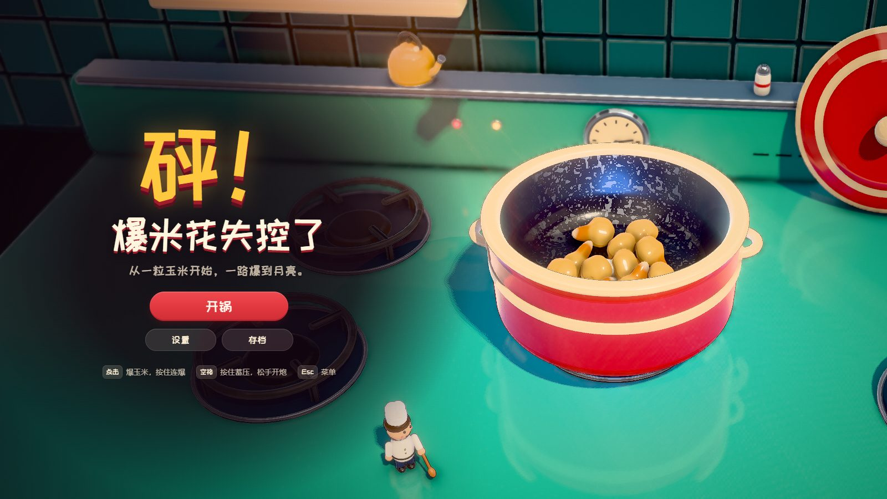
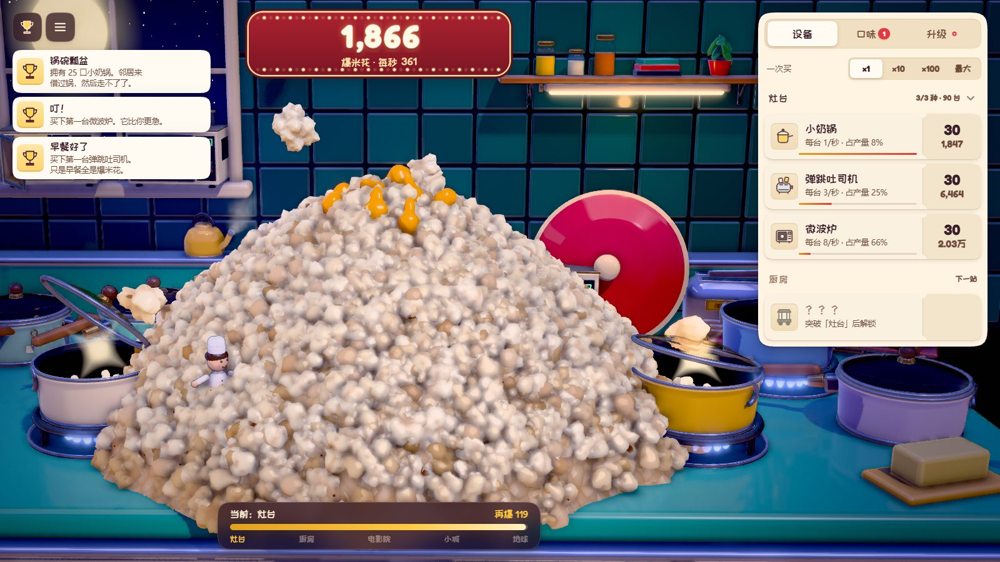
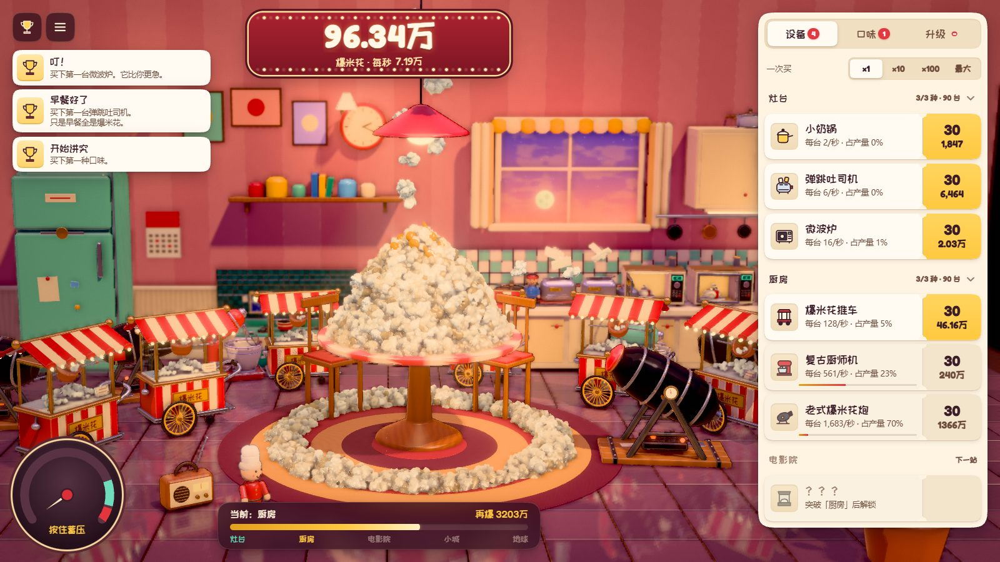
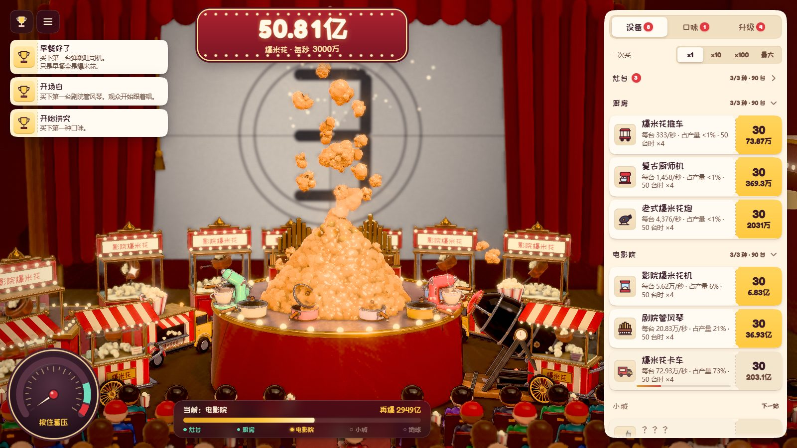
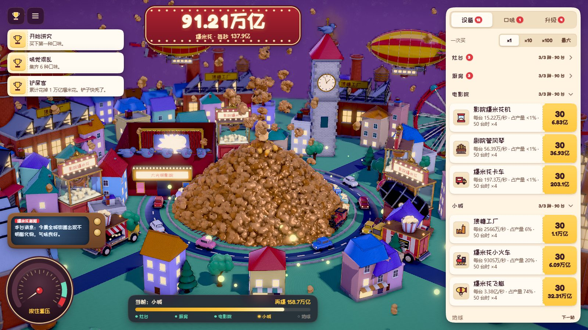
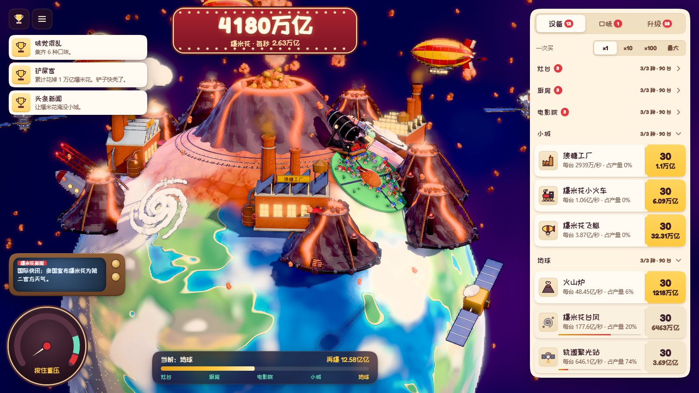
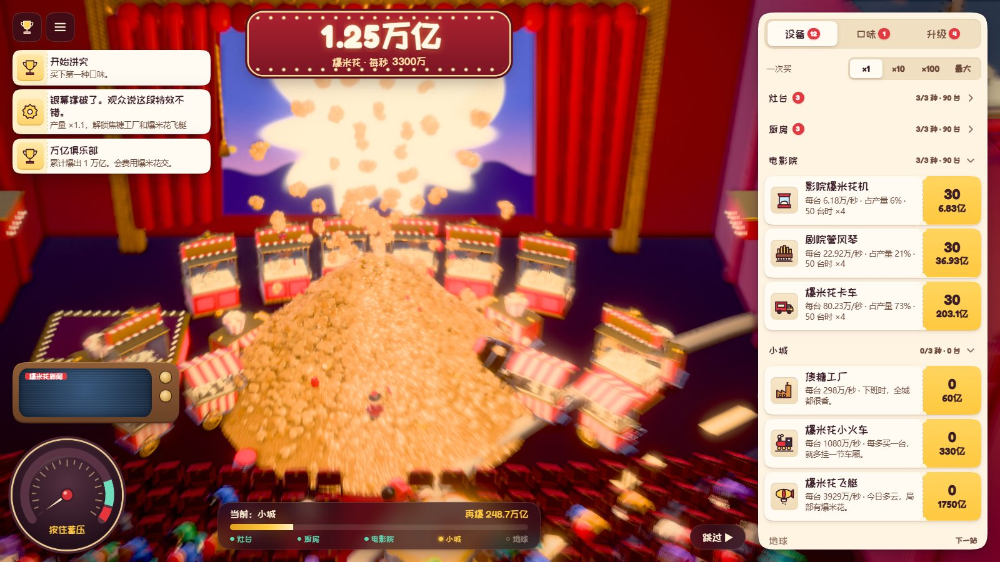
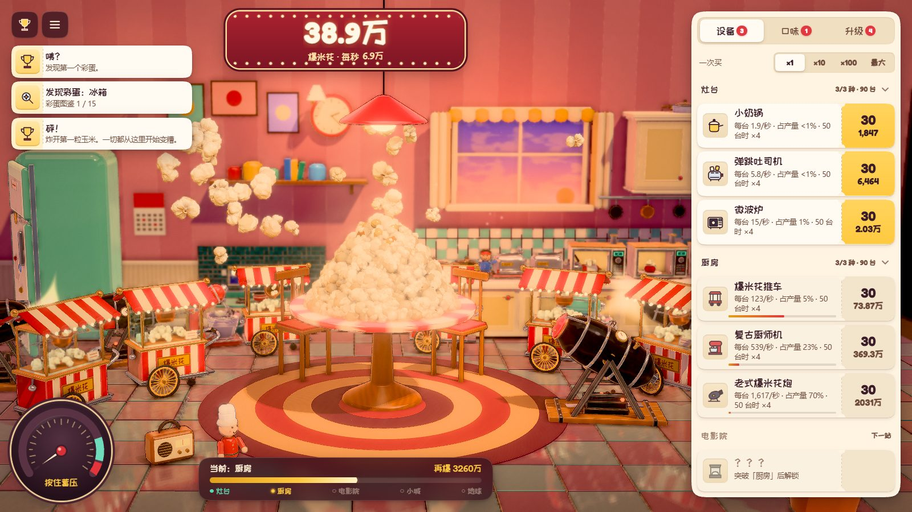
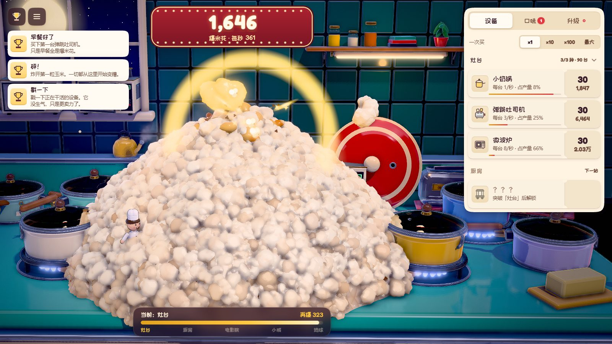

<h1 align="center">🍿 POP! THE POPCORN GOT OUT OF HAND</h1>

<p align="center"><sub>砰！爆米花失控了</sub></p>

<p align="center">
  <a href="https://seiya058904.github.io/popcorn/">
    
  </a>
  <br />
  <sub>REAL IN-GAME CAPTURE · EVERY MODEL, TEXTURE AND SOUND IS MADE BY THE GAME'S OWN CODE</sub>
</p>

<p align="center">
  <strong>One kernel. Fifteen machines. Until the moon goes pop.</strong>
</p>

<p align="center">
  A 3D toy-miniature incremental game for the browser.<br />
  Pop a kernel on the stove, buy ever larger machines, and watch the heap burst out of<br />
  the kitchen, the cinema and the town until the whole planet is popcorn.
</p>

<p align="center">
  <a href="https://seiya058904.github.io/popcorn/"><strong>▶ Play in Your Browser</strong></a>
  &nbsp;·&nbsp;
  <a href="#the-five-scenes">🌍 Five Scenes</a>
  &nbsp;·&nbsp;
  <a href="#how-it-plays">🎮 How It Plays</a>
  &nbsp;·&nbsp;
  <a href="#controls">⌨️ Controls</a>
  &nbsp;·&nbsp;
  <a href="#run-locally">⚙️ Run Locally</a>
</p>

<p align="center">
  <sub>15 MACHINES &nbsp;·&nbsp; 5 SCENES &nbsp;·&nbsp; 120 UPGRADES &nbsp;·&nbsp; 12 FLAVORS &nbsp;·&nbsp; 45 ACHIEVEMENTS &nbsp;·&nbsp; 15 HIDDEN THINGS &nbsp;·&nbsp; ABOUT 2.5 HOURS</sub>
</p>

<p align="center">
  
  
  
  
  
</p>

---

> **The first click pops one kernel. The last one pops the moon.**
>
> You start with a single kernel in a pot. Every pop lands on a heap that keeps growing, the heap keeps paying, and the money buys machines that pop for you: a toaster that fires bricks of popcorn, a theatre organ that plays it through its pipes, a little train that hauls it round the town square. When a scene is full, the pot, bowl, bucket or fountain bursts, the camera climbs out, and the whole scene turns out to be a toy sitting inside a bigger one.

<a id="the-five-scenes"></a>
## 🌍 The Five Scenes

<table>
  <tr>
    <td width="50%" valign="top">
      
      <h3>🔥 01 · The Stove</h3>
      <p><sub>SAUCEPAN · POP-UP TOASTER · MICROWAVE</sub></p>
      <p>A mint 1950s range at dusk. The moon creeps up behind the window sill and twitches more and more as the evening goes on.</p>
    </td>
    <td width="50%" valign="top">
      
      <h3>🥣 02 · The Kitchen</h3>
      <p><sub>POPCORN CART · STAND MIXER · POPCORN CANNON</sub></p>
      <p>The stove is now a toy on the counter. Afternoon turns to evening, the lamps come on, and a mouse keeps stealing flakes.</p>
    </td>
  </tr>
  <tr>
    <td width="50%" valign="top">
      
      <h3>🎬 03 · The Cinema</h3>
      <p><sub>CINEMA MACHINE · THEATRE ORGAN · POPCORN TRUCK</sub></p>
      <p>The house lights dim, the projector runs the intermission, the countdown and the feature, and the audience gets to its feet.</p>
    </td>
    <td width="50%" valign="top">
      
      <h3>🏙️ 04 · The Town</h3>
      <p><sub>CARAMEL FACTORY · POPCORN TRAIN · POPCORN AIRSHIP</sub></p>
      <p>From afternoon to a starry night: street lamps, shops, the Ferris wheel and four waves of windows come on one after another.</p>
    </td>
  </tr>
  <tr>
    <td width="50%" valign="top">
      
      <h3>🌍 05 · The Earth</h3>
      <p><sub>VOLCANO OVEN · POPCORN TYPHOON · ORBITAL SPOTLIGHT</sub></p>
      <p>Popcorn drifts creep down from the pole while night sweeps round the planet and the moon draws closer. Then it gets out of hand.</p>
    </td>
    <td width="50%" valign="top">
      
      <h3>💥 Breakouts</h3>
      <p><sub>STRAIN · SILENCE · BLAST · CLIMB OUT</sub></p>
      <p>The vessel trembles and cracks, everything goes quiet, it blows, and the camera climbs out to show the scene was a miniature all along.</p>
    </td>
  </tr>
</table>

<a id="how-it-plays"></a>
## 🎮 How It Plays

**Pop, buy, watch it grow.** Clicking pops kernels; holding keeps popping. Machines pop on their own, each with its own working animation and sound, and every one of the fifteen gets a new look at 25, 50 and 100 owned. Clicking speeds things up but is never required: upgrades can stir the pot, fire the cannon and catch kernels for you, and a player who never clicks still reaches the end.

**The cannon.** Hold <kbd>Space</kbd> or the pressure gauge and let go in the green zone for a big shot. An upgrade rewards chains of green shots with a growing bonus.

**The hopping kernel.** Now and then an orange kernel bounces out. Catch it for a frenzy: everything runs warmer, the lights pulse with the music and production multiplies.

**Golden kernels.** With the right upgrade, a click can turn up a golden kernel. It swells gold, bursts into a gold-leaf flake, trails glitter and rings the heap where it lands.

**Flavors and decorations.** Twelve flavors, from butter and sea salt to rainbow, starry and a mystery flavor, each recoloring the whole heap. Ten decorations, two per scene, from a neon sign to an aurora.

**Poke things.** Point at a working machine and it lifts a little; poke it and it squashes, springs back and works one extra cycle.

**Fifteen hidden things.** Three per scene. A wall clock, a pepper shaker, a fridge, a radio, the projector, a curtain cord, the pigeons, a satellite, the moon… each one plays a short gag and joins the album in the achievements page.

**The end, and another pot.** The ending has credits and a few surprises. Afterwards, "Another Pot" (再来一锅) starts over with a permanent production bonus and a new pot, keeping achievements and both albums.

<p align="center">
  
  
  <br />
  <sub>A HIDDEN THING FOUND · A GOLDEN KERNEL</sub>
</p>

<a id="controls"></a>
## ⌨️ Controls

| Input | Action |
|---|---|
| Click the pot, bowl or heap | Pop kernels |
| Hold the mouse button | Keep popping |
| Point at a machine, then click | Poke it |
| Click something that looks out of place | It might be one of the hidden things |
| Hold <kbd>Space</kbd> or the pressure gauge, release in the green zone | Fire the cannon |
| Click the bouncing orange kernel | Start a frenzy |
| <kbd>Esc</kbd> | Pause, settings and saves |

The game is made for a desktop screen and a mouse. Phones and small windows get a short notice first and can still go on. All text in the game is Simplified Chinese.

## 💾 Saves and Settings

- Saves are automatic: every 30 seconds and whenever the page is hidden or closed. They live in IndexedDB, falling back to `localStorage` and then to memory.
- A backup copy is kept, and a damaged save is restored from it. The pause menu can export a save as text and import it in another browser.
- Time away earns a capped share of normal production. Moving the system clock backward earns nothing.
- Settings: master, music, effects and interface volume, haptic feedback (on devices that vibrate), graphics quality (automatic or four fixed tiers), show speed, reduced camera motion and screen shake. The system's reduced-motion preference is honored on first launch.

<a id="run-locally"></a>
## ⚙️ Run Locally

You need [Node.js 24](https://nodejs.org/) and a current desktop browser with WebGL 2 and hardware acceleration.

```bash
npm ci
npm run build
npm run preview      # then open the address it prints, normally http://localhost:4173/
```

`npm run dev` runs a development server with hot reload. `npm run build` writes a static site to `dist/` with relative paths, so it can be served from any folder of any static web server, over HTTP or HTTPS (browsers do not load modules from `file://`).

| Command | Purpose |
|---|---|
| `npm run check` | Type checks and unit tests |
| `npm run e2e` | End-to-end tests in Chromium and Firefox, plus Chrome and Edge when installed |
| `npm run e2e:prod` | Build, then test the production site |
| `npm run balance` | Economy simulation, written to `docs/BALANCE.md` |
| `npm run budget` | Worst-case draw calls and triangles in every scene |
| `npm run audio` | Loudness, clipping and mix checks, including an offline render of the real mixer (needs `ffmpeg`) |
| `npm run shots` | Review screenshots; add `--verify` to check they are reproducible |
| `npm run turntable` | Close-ups of every machine from four sides |
| `npm run playthrough` | Plays the real game with a simulated player |
| `npm run soak` | Real-time stress run with memory tracking |
| `node tools/perf.ts` | Frame times; `--capped` at the display rate, `--trace`, `--paints`, `--breakout --from-title`, `--cpu-throttle=4` |
| `node tools/first-visit.ts` | A first visit to the production build on a throttled connection |

The first end-to-end run needs browsers: `npx playwright install chromium firefox`.

<details>
<summary><strong>🛠️ Under the Hood</strong></summary>

- **Everything is generated.** Machines, scenes, popcorn, textures, signs, shaders, music and sound effects are all made by code at load time. There are no model, texture or audio files.
- **Rendering:** three.js on WebGL 2 with a custom toon-and-enamel material set, a heightfield heap with instanced surface flakes, refracting glass (high and ultra), screen-space reflections on polished floors, soft shadows, ground-truth-style ambient occlusion, a tilt-shift focus band, bloom, and camera motion blur during breakouts.
- **Draw calls:** each machine type is one "part rig": all its parts in one mesh, posed from a small float texture, so a scene with every slot filled stays within 120 draw calls and 13 million triangles in the worst case (`npm run budget`).
- **Background building:** the next scene is built a few milliseconds per frame while you play, its shaders compile in parallel, and its buffers go to the GPU one piece per frame.
- **Rules apart from rendering:** the economy runs at a fixed 10 steps a second in `src/sim` with no browser dependencies, so the balance simulator plays the real rules.
- **Measured on one desktop** (Radeon RX 7900 XT, Chrome): every scene holds 60 FPS at 4K on the highest setting with ten clicks a second; with the CPU slowed down four times, 1080p on low still holds 60 FPS. A first visit on a simulated 10 Mbps connection shows the loading screen in about 0.4 s and the title in about 2.3 s.

```text
src/sim, src/content, src/events   Game rules and data, with no browser dependencies
src/render                         Scenes, machines, materials, popcorn and post-processing
src/audio                          Procedural sound and music
src/ui, src/platform               Interface, saves and settings
src/debug                          QA tools, removed from production builds
tools, tests                       Verification tooling and tests
docs                               Design, plan, balance report and credits
```

</details>

## 🧪 Verification

- Unit tests cover prices, multipliers, offline time, save migration and damage, content, story timing and interface rules.
- End-to-end tests run the real game in Chromium, Chrome and Firefox: layout at six window sizes, every button's press-and-release behavior, the shop, the cannon, saves, the ending, pokes, and all fifteen hidden things found by clicking them on screen.
- Production tests check the built site; the same tests were run against the live site after it was deployed.
- GitHub Actions type-checks, runs the unit tests and builds before deploying to GitHub Pages.
- `docs/EXECUTION_PLAN.md` records every phase with the checks that were actually run and their results.

## ⚠️ Known Limitations

- Edge has not been tested; Chromium and Chrome pass, and Edge shares their engine.
- Performance was measured on one desktop with a Radeon RX 7900 XT. Integrated graphics and laptops have not been tested on real hardware; the automatic quality setting lowers resolution and then detail when frames run long.
- A breakout can drop one frame at 60 FPS. While the town and the Earth are built in the background, one or two build steps take 18–25 ms.
- Game feel, sound and art direction have been checked with frame captures and loudness analysis, not yet by a group of human players. Pacing was tuned with simulated players: about 2.5 hours for an active player and about 3.3 hours for one who never clicks.
- Simplified Chinese is the only language.

## 🎨 Credits and License

All models, textures, shaders, music and sound effects are generated by the game's own code. Third-party parts: [three.js](https://threejs.org) (MIT), and subsets of [ZCOOL KuaiLe](https://github.com/googlefonts/zcool-kuaile) and [Fredoka](https://github.com/hafontia/Fredoka-One) (SIL Open Font License 1.1). Their license texts ship in every build; see [docs/CREDITS.md](docs/CREDITS.md).

The original code, art, audio, writing and branding are © seiya058904, all rights reserved; see [LICENSE](LICENSE). Third-party components keep their own licenses.

---

<p align="center">
  <strong>Click once. Then let it pop.</strong><br />
  <sub>砰！爆米花失控了</sub>
</p>
